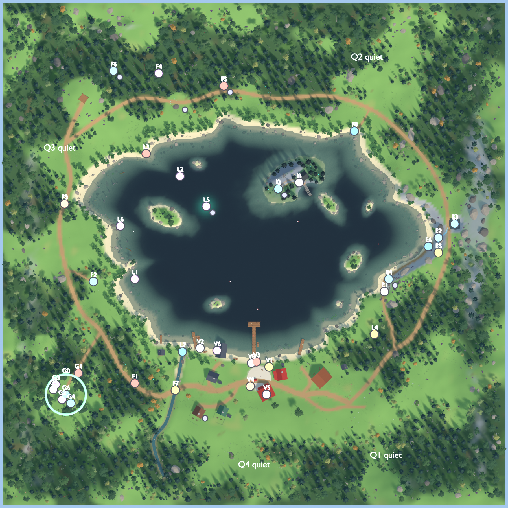

# Sunshore Bay – sijoittelusuunnitelma (vaihe A)

Tila: **vaihe B tehty (10.11.2026).** Kaikki kohteet on lisätty mappiin blockout-objekteina (kokoelma `PointsOfInterest`), ja kuvat ovat tiedostoissa `renders/v2/SunshoreBay_POI_*.png`. Odottaa visuaalista hyväksyntää (vaihe C).

Muutokset suunnitelmaan toteutuksessa: lampi (E3) siirtyi kohtaan (160, 24) korkeammalle ylängölle, luolan suu (E4) kallioseinän juurelle (107.5, −20), ja Lure Tree poistettiin Forgotten Isleltä.

- Kohteiden tarkat sijainnit ovat yhdessä tiedostossa: [`plan/map_plan.json`](plan/map_plan.json). Vaiheen B blockout lukee saman tiedoston, joten tietoja ei ole kahdessa paikassa.
- Karttakuva: [`renders/v2/SunshoreBay_Plan.png`](renders/v2/SunshoreBay_Plan.png). Pohjoinen on ylhäällä, ja tunnukset ovat samat kuin alla.
- Tarkistus: `blender -b Blender/SunshoreBay/SunshoreBay_Blockout_v2.blend --python Blender/SunshoreBay/scripts/render_plan.py` tarkistaa jokaisen pisteen maastosta (maa vai vesi ja korkeus) ja laskee etäisyydet.

Koordinaatit ovat metreinä (Blender X, Y = Unity X, Z). Kylän aukio on kohdassa (4, −99), järven keskipiste (0, 15) ja Forgotten Isle (32, 60).

## 1. Sunshore Village

Jo mapissa: kauppa, 4 mökkiä, venevaja, varasto, aukio, 3 laituria, lyhdyt, viitat, ilmoitustaulu, penkit, verkot ja tynnyrit.

| ID | Kohde | Paikka | Löydettävyys |
|---|---|---|---|
| V1 | **Kalojen myyntipiste** (katos, jää- ja kalalaatikot) | (12, −90), aukion ja laiturin välissä | helppo |
| V2 | Kiinnityspollarit ja toinen vene länsilaiturille | (−43, −75) | helppo |
| V3 | Kyltti **KEEP OFF THE WATER AFTER SUNSET** | päälaiturin suu (2, −86) | helppo |
| V4 | Kadonneen kalastajan ilmoitus ilmoitustaululla | (9.5, −104.5) | helppo |
| V5 | Vanha järvikartta kaupan takaseinällä, Forgotten Isle ympyröitynä | kaupan sisällä (10, −112) | keskitaso |
| V6 | Naarmut venevajan länsiseinässä | (−29.4, −77) | keskitaso |
| V7 | Outo valo ikkunassa öisin | sininen mökki (−44, −126) | yö |
| V8 | Penkki laiturin suulle, verkkokasa ja kalalaatikoita (asuttu, ei liian siisti) | (−2, −87) | helppo |

## 2. Pinewood Forest

| ID | Kohde | Paikka | Löydettävyys |
|---|---|---|---|
| F1 | Kyltti **DON'T GO INTO THE WOODS AFTER DARK** ja alle raaputettu **IT HEARS YOU**. Vino ja sammaleinen. | läntisen polun suu (−95, −103) | helppo |
| F2 | **Hylätty kalastajan leiri** (nuotio, tuoli, vapa, rikkinäinen lyhty, laatikot) pienellä aukealla | (−128, −22), noin 20 m polulta | keskitaso |
| F3 | Puuhun naulattu **MISSING – LAST SEEN NEAR THE LAKE**, kastunut ja repeytynyt | läntinen polku (−151, 40) | keskitaso |
| F4 | Raapimisjäljet 4–6 m korkeudella kolmessa isossa kuusessa | (−76, 144) | piilossa |
| F5 | Puutolppa ja ruostunut kello, teksti **IF YOU HEAR THREE BELLS, RUN** | pohjoislenkki (−24, 134) | keskitaso |
| F6 | **Sammaleinen vene keskellä metsää**, pohjassa suuret jäljet | (−112, 146), noin 60 m rannasta | piilossa |
| F7 | Puro ja puusilta (jo mapissa). Lisäksi astinkivet ja purokivet. | silta (−62.7, −108.5) | helppo |
| F8 | **Piilotettu kalastuspaikka:** kapea polku koillispoukamaan, vanha laituri tai kallio | (80, 98) | piilossa |
| F9 | Auringonsäteet aukeilla (Unity, 05 Atmosphere) | aukea (−60, 120) ja lehto | – |

## 3. Ancient Grove (lounas)

Lehto on noin 80 m kylän länsilaidalta. Sinne vie sivupolku läntiseltä metsäpolulta: (−122, −62) > (−138, −88) > (−148, −104). Lehtoon pääsee jo päivällä.

| ID | Kohde | Paikka |
|---|---|---|
| G0 | Aukea (r noin 16 m), 6–7 jättipuuta suurine juurakoineen, kaatunut jättirunko ja kivimerkit | keskipiste (−150, −112) |
| G1 | Kyltti **DON'T FOLLOW THE LIGHTS** | sisäänkäynti (−140, −95) |
| G2 | Kivi, jossa on vanha symboli. **Nykyinen riimukivi siirretään tähän**, ei uutta kopiota. | (−153, −116) |
| G3 | Kaiverretut merkit 2–3 jättipuussa | (−158, −104) |
| G4 | Yksi pieni sinertävästi hohtava kasvi | (−146, −119) |
| G5 | Vanha reppu ja puulaatikko | (−156, −109) |
| G6 | **Nykyiset leijuvat valot siirretään tänne.** Nyt niitä on kahdella metsäaukealla, jatkossa vain täällä ja Forgotten Islellä. | lehto |

## 4. Eastern Cliffs

Mittasin maaston: kallioseinä nousee lännen puolella kohdassa x 108 → 116 (y = −20) ja pohjoisempana kohdassa x 142 → 150 (y = 4…14). Kallioylänkö on 10–15 m korkealla.

| ID | Kohde | Paikka |
|---|---|---|
| E1 | Kapea rantapolku kallion juurella: (110,−60) > (104,−44) > (103,−28) > (105,−14) > (114,−2) > (128,6) > (138,9) | kallion juuri |
| E2 | Pieni, noin 7 m korkea vesiputous rantakivikkoon | (147, 13) |
| E3 | **Piilotettu lampi** kallioylängöllä, vesiputouksen lähde | (154, 20) |
| E4 | **Luolan suu** kallioseinässä, suljettu lankuilla ja kivillä. Teksti **DO NOT ANSWER THE WHISTLING**. | (112, −20) |
| E5 | Puinen näköalatasanne kallion päällä | (147, 1) |
| E6 | Kalastuspaikka rantakalliolla vesiputouksen alla | (139, 6) |

## 5. Sunshore Lake

Jo mapissa: rannat, kaislikot, kivireunat, 4 saarta ja 4 luotoa, poijut, avoin vesi, hukkuneet puut, syvä valo ja uponnut vene.

| ID | Kohde | Paikka | Löydettävyys |
|---|---|---|---|
| L1 | **Hylky matalassa vedessä** (noin 1,7 m), näkyy pinnalta | (−95, −20) | helppo |
| L2 | **Outo poiju**, vanha ja symbolillinen. **Korvaa** nykyisen PROP_Buoy_04:n. | (−59, 62) | keskitaso |
| L3 | Kyltti **THE LAKE IS NOT EMPTY** syrjäisellä rannalla | (−86, 80) | piilossa |
| L4 | Rantakatos ja kyltti **IF THE FISH STOP BITING, LEAVE** | (96, −64) | keskitaso |
| L5 | Syvä himmeä valo ja tyyni vesi sen yllä (jo mapissa) | (−38, 38) | keskitaso |
| L6 | Hukkuneet kelot ja tukit (jo mapissa) | (−107, 22) | helppo |
| L7 | Uusi kalastuspaikka puron suulle | (−57, −78) | helppo |

**Kalastuspaikat:** nykyiset 7 + piilopoukama (F8) + rantakallio (E6) + puron suu (L7) = 10. Ne jakautuvat kylään, avovedelle, rannoille ja saaren luo.

## 6. Forgotten Isle

Jo mapissa: epäsymmetrinen saari, korkeuserot, vino mökki, rikkinäinen laituri, kivikehä, obeliski, tummat puut, kelot, sammalkivet ja hehkuvat ikkunat.

| ID | Kohde | Paikka |
|---|---|---|
| I1 | Hylätyt kalastusvälineet: vavat, verkkokasa ja laatikot | laiturin tyvi (36, 57) |
| I2 | Himmeät symbolit kivikehän kivissä | kivikehä (19.3, 51.9) |

## 7. Kyltit ja varoitukset

Kahdeksan tekstiä on sijoitettu seitsemään paikkaan. Kaksi niistä on samassa kyltissä (F1), koska teksti "IT HEARS YOU" on raaputettu sen alle.

| Teksti | Paikka | Löydettävyys | Lähin toinen varoitus |
|---|---|---|---|
| KEEP OFF THE WATER AFTER SUNSET | V3 laituri | helppo, aloitusalue | 98 m |
| DON'T GO INTO THE WOODS AFTER DARK + IT HEARS YOU | F1 metsän suu | helppo | 46 m (G1, lehdon sisällä) |
| IF YOU HEAR THREE BELLS, RUN | F5 pohjoislenkki | keskitaso | 82 m |
| IF THE FISH STOP BITING, LEAVE | L4 rantakatos | keskitaso | noin 50 m (E4) |
| DON'T FOLLOW THE LIGHTS | G1 lehto | piilossa | 46 m |
| THE LAKE IS NOT EMPTY | L3 syrjäranta | piilossa | 82 m |
| DO NOT ANSWER THE WHISTLING | E4 luola | piilossa | noin 50 m |

- Aloitusalueelta näkyy vain yksi varoitus (V3). Toinen (F1) tulee vastaan, kun pelaaja lähtee metsään.
- Kaikki varoitukset ovat vähintään 46 m päässä toisistaan, eikä kahta voi nähdä samasta kohdasta, koska metsä ja kallio peittävät näkymän.

## 8. Yökohtausten paikat (vain merkkipisteet, ei toteutusta)

Merkkipisteet ovat `MK_Night_WindowLight` (V7), `MK_Night_LakeLights` (L5), `MK_Night_Bells` (F5), `MK_Night_Whistling` (E4), `MK_Night_ForestListener` (F6) ja `MK_Night_IsleCircle` (I2). Ne näkyvät kartassa pieninä pisteinä varsinaisen paikan vieressä.

## 9. Onko mappi liian täynnä?

**Ei ole.** Mapissa on 34 uutta tai muuttuvaa kohdetta noin 132 000 m²:n maa-alalla, eli keskimäärin yksi kohde 3 900 m²:ä kohden (noin 60 × 60 m).

- **Tiheimmät kohdat ovat tarkoituksella pieniä:** kylä, jossa V1–V8 ovat noin 30 m säteellä, ja lehto, jossa G0–G6 ovat 16 m säteellä. Ne ovat kuin pieniä huoneita.
- **Hiljaiset alueet**, joihin ei tule mitään uutta:
  - Q1 kaakon metsä ja niitty
  - Q2 koillisen metsä (vain piilopolku kulkee reunalla)
  - Q3 läntinen ylänkö näköalapaikan ja polun välissä
  - Q4 kylän takainen etelämetsä
- **Magia on keskitetty kolmeen paikkaan:** lehtoon (valot, hohtava kasvi, symbolikivi), Forgotten Islelle ja syvälle järveen. Muualla magiaa on vain harvinaisina hohtosammalina ja yksittäisenä keijurenkaana.

**Jokaisella pääalueella on:**

| Alue | Identiteetti | Maamerkki | Kulkureitti | Tutkittavaa | Yhteys järveen |
|---|---|---|---|---|---|
| Kylä | värikäs satama | päälaituri ja aukion kaivo | raitti ja laiturit | V4–V6 | satama |
| Metsä | tumma havumetsä | metsävene F6 | länsipolku ja pohjoislenkki | F2–F6 | rannat, F8 |
| Lehto | vanha ja outo | jättipuut | sivupolku | G1–G5 | puro (etelässä) |
| Kalliot | jylhä kivi | vesiputous | rantapolku | luola, lampi | rantakallio E6 |
| Järvi | tumma syvyys | syvä valo, hukkuneet puut | veneily | hylky, poiju | – |
| Forgotten Isle | hylätty ja kaunis | kivikehä ja obeliski | laituri ja kivipolku | I1, I2, mökki | saari |

## 10. Vaiheessa B tarvittavat maastomuutokset (World & Map)
- Lehdon aukea ja leirin aukea lisätään aukeiden listaan, ja sivupolut (lehto, leiri, piilopoukama ja kallion rantapolku) lisätään polkulistaan.
- Kallioylänköön tehdään painauma lammelle ja purouoma vesiputoukselle.
- Riimukivi ja leijuvat valot siirretään lehtoon (ei kopioita), ja PROP_Buoy_04 korvataan oudolla poijulla.

## 11. Kenelle mikin kuuluu
- **01 World & Map:** kaikki sijainnit, polut, maasto ja blockout-objektit.
- **02 Buildings & Nature:** lopulliset mallit vasta hyväksynnän jälkeen (myyntipiste, kyltit, leiri, kello, vene, luolan suu, näköalatasanne).
- **05 Atmosphere & Horror:** valot, auringonsäteet ja yökohtaukset merkkipisteiden kohdalla.
- **06 Unity Integration:** pieni testialue Unityyn (vaihe E).
