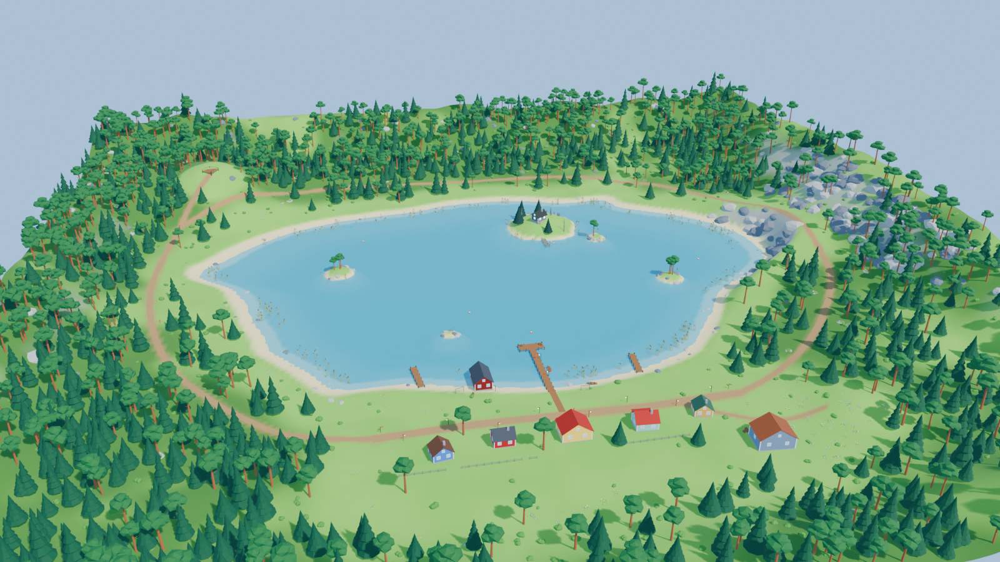

# LURELOOM – Sunshore Bay (blockout)

Ensimmäinen pelialue tuotantosuunnitelman (`LURELOOM_PRODUCTION_PLAN.md`, luku 7) mukaan.
Mappi on **blockout** eli pohjahahmotelma: mittakaava, sijoittelu ja värit ovat oikein, mutta mallit ovat yksinkertaisia tyyliteltyjä muotoja. Lopulliset mallit tehdään myöhemmin, ja ne korvaavat blockout-mallit yksi kerrallaan.

Tila: **odottaa sijoittelun hyväksyntää.** Ei vielä commitattu.



## Mittakaava
- 1 Blender-yksikkö = 1 metri, Z ylöspäin. Mappi on 400 × 400 m (X ja Y välillä −200…200).
- Järven pinta on korkeudella z = 0. Kylän maanpinta on noin 1,3–4 m.
- Pelaajan silmän korkeus renderöinneissä on 1,7 m. Mittakaavanuket (`REF_Human180_*`) ovat 1,8 m korkeita.
- Rakennukset:

  | Rakennus | Leveys × syvyys | Seinän korkeus |
  |---|---|---|
  | Mökit | 6–7,5 × 5,5–6,5 m | 2,7–3,0 m |
  | Kauppa | 10 × 8 m | 3,6 m |
  | Varasto | 12 × 9 m | 4,2 m |
  | Venevaja | 6,5 × 10 m | 3,0 m |

  Kaikissa on 0,45 m korkea sokkeli. Ovet ovat 2,1 m korkeita (venevajan ja varaston ovet 3 m).
- Laiturin kansi on 1,0 m vedenpinnan yläpuolella. Päälaiturin pituus on 30 m, minkä lisäksi on 10 m leveä T-pää. Laiturit ovat 2,4–2,6 m leveitä.

## Alueet
| Alue | Sijainti | Sisältö |
|---|---|---|
| **Sunshore Lake** | keskellä, noin 250 × 180 m | poukamat, hiekkarannat, syvyys noin 7 m, kaislikot matalikoilla, 4 pientä saarta |
| **Sunshore Village** | etelärannalla (ranta y ≈ −83, raitti y ≈ −103) | kalastustarvikekauppa, 4 erilaista mökkiä, venevaja, varasto, 3 laituria, puupolku, lyhdyt, tynnyrit, laatikot, aidat, viitat, verkkotelineet, 3 soutuvenettä |
| **Pinewood Forest** | järven ympärillä, tiheintä lännessä ja pohjoisessa | noin 1 700 mäntyä ja kuusta, pensaat, kukat, sammaleiset kivet |
| **Itäkalliot** | itäranta | jyrkkä kallioranta isoine kivineen, polku kallion päälle |
| **Näköalapaikka** | luoteiskukkula (−136, 124) | puinen näköalatasanne |
| **Kukkaniitty** | kylän kaakkoispuolella (88, −128) | aukea niitty, kukkia |
| **Forgotten Isle** | järven pohjoisosassa (35, 62) | hylätty vino mökki hehkuvine ikkunoineen, rikkinäinen laituri, 7 kiven kehä ja hehkuva obeliski, tummat kuuset, kuolleita puita |

Polut kulkevat kylästä länteen metsän läpi näköalapaikalle, itään rantaa pitkin kallioille, ja pohjoispuolella kulkee lenkki järven ympäri. Lisäksi niitylle vie oma polku.

## Objektien nimeäminen ja rakenne
Jokainen rakennus, laituri, puu ja esine on oma objektinsa. Mappia ei ole tehty yhtenä meshinä.

| Etuliite | Merkitys |
|---|---|
| `TERRAIN_` | maaston referenssimesh (2 m:n ruudukko, värit vertex coloreina). Lopullinen maasto tehdään Unityssä. |
| `WATER_` | vedenpinnan taso (z = 0) |
| `BLD_` | rakennukset |
| `DOCK_` | laiturit |
| `STR_` | muut rakenteet (näköalatasanne) |
| `PATH_` | polut ja puupolut (erilliset nauhameshit, käyvät pohjaksi Unityn splineille) |
| `TREE_`, `BUSH_`, `FLOWERS_`, `ROCK_`, `REEDS_` | kasvillisuus ja kivet |
| `PROP_`, `BOAT_` | esineet ja veneet |
| `ISLE_` | Forgotten Islen erikoisobjektit |
| `MK_` | Unityn merkkipisteet: `MK_PlayerSpawn`, `MK_FishingSpot_00…06`, `MK_Zone_*` |
| `REF_Human180_` | 1,8 m mittakaavanuket. Vain tarkistukseen, ei Unityyn. |
| `CAM_`, `SUN_` | kamerat ja valo |

Collection-rakenne: `SunshoreBay / Terrain, Water, SunshoreVillage (Buildings, Docks, Props), PinewoodForest (Trees, Bushes_Flowers), Rocks, Reeds, Paths, ForgottenIsle, SmallIslands, Markers, Lights_Cameras`.

Puut, kivet ja esineet ovat linkitettyjä kopioita prototyyppimeshistä. Prototyypit ovat kokoelmassa `_Prototypes`, joka on piilotettu. Kun prototyypin mesh vaihdetaan lopulliseen malliin, kaikki sen kopiot päivittyvät kerralla.

## Generointiskripti
Koko mappi syntyy proseduraalisesti tiedostosta `scripts/build_sunshore_bay.py`. Sijoittelu on käsin ohjattua: alueet, polut, rakennukset ja saaret on määritelty skriptissä, ja kasvillisuus sijoitellaan niiden ympärille tiheyskarttojen avulla.

Aja komento repon juuresta:

```
blender -b --python Blender/SunshoreBay/scripts/build_sunshore_bay.py              # .blend + kaikki renderöinnit (~15 s)
blender -b --python Blender/SunshoreBay/scripts/build_sunshore_bay.py -- --no-render  # pelkkä .blend (~4 s)
```

Säätäminen tapahtuu skriptin vakioista:
- `SEED`: satunnaisuus
- `LAKE_A/B`, `COVES`: järven muoto
- `ISLANDS`, `VIEWPOINT`, `MEADOW`: saaret ja kiintopisteet
- `PATHS`: polkujen reitit
- `house(...)` / `dock(...)` -kutsut: kylän rakennukset ja laiturit
- `forest_density()`: metsän tiheys

Tuotokset:
- `SunshoreBay_Blockout.blend`
- `renders/*.png`

## Renderöinnit
| Kuva | Näkymä |
|---|---|
| `SunshoreBay_Overview.png` | yleiskuva etelästä |
| `SunshoreBay_Top.png` | ylhäältä (ortografinen, 405 m) |
| `SunshoreBay_Village.png` | kylä järveltä päin |
| `SunshoreBay_ForgottenIsle.png` | saari järveltä |
| `SunshoreBay_Eye_VillageStreet.png` | pelaajan korkeudelta kyläraitilla itään |
| `SunshoreBay_Eye_MainDock.png` | päälaiturin päästä kylään päin |
| `SunshoreBay_Eye_DockToLake.png` | päälaiturilta järvelle ja Forgotten Islelle |
| `SunshoreBay_Eye_ForestPath.png` | läntiseltä metsäpolulta |
| `SunshoreBay_Eye_ForgottenIsle.png` | saaren rikkinäiseltä laiturilta mökille |

## Muutokset tässä versiossa
- Kylän takana oleva rinne loivennettiin: kylän tasoitus häivytetään 40 m matkalla, ja kukkulat ja reunaharju ovat matalampia kylän takana. Paljasta kalliota näkyy enää vain oikeilla kallioilla ja hyvin jyrkillä kohdilla.
- Verkkotelineissä on nyt avoin köysiverkko (vaaleat köysisäikeet) sekä oranssit ja valkoiset kohot. Tumma levy poistettiin.
- Puut pidetään vähintään 3,8 m päässä polkujen reunasta.
- Lisättiin 5 kameraa pelaajan silmän korkeudelle ja 1,8 m mittakaavanuket.

## Havainnot (mittakaava, sommittelu, näkyvyys)
- **Mittakaava:** 1,8 m nukke ja 2,1 m ovet sopivat yhteen. Mökit tuntuvat kolmannen persoonan kamerasta hieman pieniltä. Ne kannattaa ehkä suurentaa 10–15 %, kun lopullinen mökki mallinnetaan.
- **Näkyvyys järvelle:** järvi näkyy kyläraitilta vasemmalla ja päälaiturilta hyvin. Rakennukset ovat raitin eteläpuolella päädyt järvelle päin, joten ne eivät peitä järveä.
- **Forgotten Isle** sulautuu laiturilta katsottuna pohjoisrannan metsään. Saari tarvitsee oman siluetin, esimerkiksi korkean kalliokärjen, ison kuolleen puun tai sumua, jotta se erottuu kiinnostavana kohteena.
- **Saaren mökki** on kumpareen päällä, joten sokkelia näkyy paljon. Maasto kannattaa tasoittaa mökin kohdalta.
- **Metsäpolku** toimii: pelaaja näkee polun jatkuvan mäen yli, ja kuuset reunustavat sitä.
- Itäkalliot näkyvät kylästä kauniisti taustalla.

## Tunnetut puutteet
- Vesi on vain litteä pinta; varsinainen vesi tehdään Unityssä.
- Ei vielä yöversiota, sumua eikä lyhtyjen valoja.
- Rakennukset, laiturit, puut ja esineet ovat blockout-malleja, eivät lopullisia.
- Maaston mesh on referenssi. Unityn Terrainiin tarvitaan oma heightmap-vienti.
- Ei vielä Unity-tuontitestiä (FBX vai glTF päättämättä).
- Puusiltaa ja portaita ei vielä ole.
- `.blend`-tiedosto on noin 2 Mt (pakattu, linkitetyt kopiot), joten Git LFS:ää ei vielä tarvita. Tarve arvioidaan uudelleen, kun lopulliset mallit tulevat.

## Seuraavat vaiheet
1. **Sijoittelun hyväksyntä** (tämä vaihe). Korjataan pyydetyt muutokset.
2. Ihmismäinen pelaajahahmo, How to Fish -henkinen: perusmalli, etu-, sivu- ja takanäkymä, riggaus, Unity-tuontitesti.
3. Ensimmäiset lopulliset assetit samalla tyylillä: kalastajamökki, laituri, mänty, kivi, soutuvene.
4. Blockout-prototyyppien vaihto lopullisiin malleihin.
5. Unity: maasto (heightmap), vesi, valaistus, päivä- ja yöversio, spawn ja kalastuspaikat merkkipisteistä.
